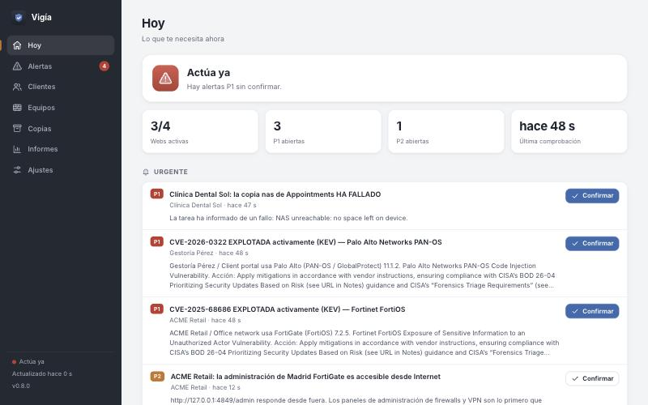
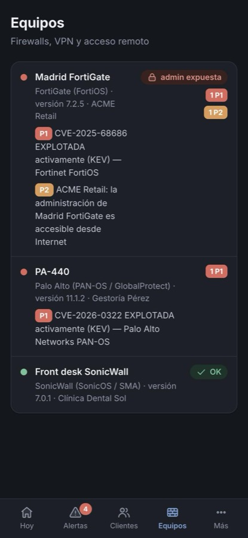

# The dashboard

Vigía's dashboard is a web app with no build step and no dependencies, and you can install it on your phone. It uses the design system of [REM-L](https://github.com/aulafy/REM-L) (MIT, same author): neutral greys, a graphite sidebar, a bottom tab bar on phones, and light and dark themes.



## Sections

| Section | What it is for |
|---|---|
| **Today** | One glance: overall status (all clear / needs attention / act now), sites up, open P1 and P2 alerts, the urgent list, and the health of alert channels and data feeds. |
| **Alerts** | Everything Vigía found. Filter by unacknowledged or all, by priority and by client, and search the text. **Acknowledge** or **Accept change** from each row. Long texts show 3 lines; click to read the rest. |
| **Clients** | One row per company, worst first, and **Add asset**. Opening a client shows its open alerts, every asset (status, response time, certificate, availability) with **Edit** and **Pause**, its devices, backups, maintenance windows and monthly report. |
| **Devices** | Every firewall, VPN gateway and remote-access tool across clients, with its version, open alerts and an **exposed admin** badge when the management interface answers from the Internet. |
| **Backups** | Every backup job: last good run, last restore test, size and any problem. |
| **Reports** | This month's and last month's report for every client, ready to print or save as PDF. |
| **Settings** | Appearance (automatic, light or dark), language (automatic, Spanish or English), maintenance windows for anything (Vigía itself included), alert channels and their last error, feeds, configuration status, and a **Send test alert** button. |

On a phone, the bottom bar shows Today, Alerts, Clients, Devices and *More*, which leads to Backups, Reports and Settings. The Alerts icon shows the number of unacknowledged P1 and P2 alerts, and so does the browser tab title.

The dashboard refreshes every 10 seconds and redraws only when something changed, keeping keyboard focus where it was. Every control works from the keyboard, there is a *skip to content* link, priority tags meet 4.5:1 contrast, and touch targets on phones are at least 44 px. It holds the refresh briefly after a tap, so a redraw never swallows a click. If Vigía cannot be reached, a banner says so and the last data received stays on screen. Banners tell an expired session (reload to sign in), a server error and a lost connection apart. A second banner warns when every alert channel is failing, or when `inventory.json` cannot be read.



## Editing assets

**Add asset** opens a form with five parts: basics (client, name, ID, domain, URL, expected text, criticality, contact), checks (turn checks off, thresholds, `.es` domain expiry, allowed foreign domains…), software, firewalls/VPN/remote access, and backup jobs. Rows can be added and removed in each list.

- Fields are checked as you type, with the same rules the server enforces (`public/validate.js`). Saving with errors highlights the fields and says why.
- The ID is proposed from the client and the name. It cannot change after creation, because alerts and history are keyed on it.
- Saving writes `inventory.json` atomically, and keeps the previous version in `data/inventory-history/` (the last 20).
- If the file changed since the form was opened (a hand edit, or another tab), saving is refused with a warning, and your changes stay in the form so you can review them and save again.
- **Pause** stops every check of an asset and keeps its alerts. Delete asks for confirmation.

## Local AI drafts

With `OLLAMA_MODEL` set, each alert has **Explain** and **Draft for the client** buttons (only **Explain** on Vigía's own alerts). The answer appears under the alert, marked as an AI draft, with Copy, Regenerate and Close. It takes about 20–30 s with a 9B model on a laptop. See [ai.md](ai.md).

## Maintenance windows

On a client's page (for that client or one asset) or in Settings (also for everything), choose a duration (1, 2, 4 or 8 hours, until 08:00 tomorrow, or a custom start and end) and an optional reason. While the window is active, alerts are recorded but not sent, and planned downtime does not count against availability. **End now** closes the window early. See [alerts.md](alerts.md#maintenance-windows).

## Install it as an app

Browsers only install web apps served over **HTTPS**, or from `localhost`. Put Vigía behind a reverse proxy with a certificate first (see [deployment.md](deployment.md#exposing-the-dashboard-optional)), and set `DASH_PASS`.

- **iPhone / iPad (Safari):** Share → *Add to Home Screen*.
- **Android (Chrome):** menu ⋮ → *Install app*.
- **Computer (Chrome, Edge):** the install icon in the address bar.

The installed app opens full screen with its own icon. The service worker keeps the app shell (HTML, CSS, JS, icons) available offline. **Alert data is never cached**, so a screen of alerts is never an old copy pretending to be current.

## Try it with demo data

```bash
npm run demo        # http://localhost:4848
```

The demo starts Vigía with three fictional clients, local test sites (one of them down), declared firewalls and backups that report in (one fails). It uses the real public feeds, so KEV and EPSS results are real. Everything is stored in a temporary folder: your `data/` is not touched.

## Security

- The page itself (`/`) asks for `DASH_PASS` when it is set. The other static files (CSS, JS, icons, manifest, service worker) contain no data, so the browser can load them without credentials.
- All data comes from `/api/state`, which requires the password, and from the dashboard host check when no password is set. Actions require the `x-vigia-ui` header, so other sites cannot trigger them (CSRF).
- Theme and language are stored in the browser (`localStorage`). Everything else lives on the server.

## Files

| File | Role |
|---|---|
| `public/index.html` | Shell with a loading skeleton |
| `public/app.js` | Router, screens and actions |
| `public/model.js` | Pure view model, shared with the tests (`test/model.test.mjs`) |
| `public/editor.js` | Asset editor and maintenance windows |
| `public/validate.js` | Asset and maintenance validation, shared with the server (`test/validate.test.mjs`) |
| `public/icons.js` | Icon set (REM-L style: 1.75 stroke plus a translucent fill layer) |
| `public/app.css` | Design tokens and layout |
| `public/sw.js`, `manifest.webmanifest` | Installable app |
| `scripts/make-icons.mjs` | Draws the PNG icons with no dependencies (`npm run icons`) |
